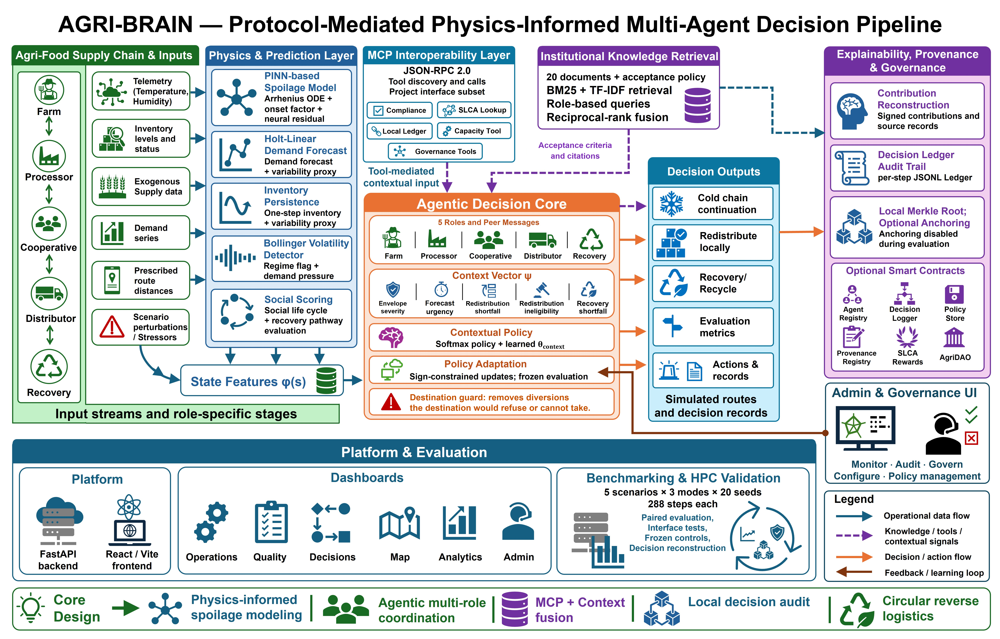

<h1 align="center">AGRI-BRAIN</h1>

<p align="center"><strong>Protocol-Mediated Decision-Level Interoperability through Context Injection<br>in Physics-Informed Multi-Agent Systems</strong></p>

<p align="center">
  <a href="https://github.com/kprodigi/AGRI-BRAIN/actions/workflows/ci.yml"></a>
  <a href="LICENSE"></a>
</p>

AGRI-BRAIN lets information held outside the deciding agent, such as a destination's acceptance criteria and its reported capacity, reach a routing decision through a standard protocol, be applied as checks, and be recorded with its reason. This repository holds the code and results of the study on a synthetic spinach cold chain reported in the paper, the figures, and scripts that verify the results and regenerate every figure from the files here.

## Architecture



*AGRI-BRAIN decision pipeline. Telemetry is transformed into physical-state features φ(s). MCP tool outputs and retrieved acceptance criteria form the context vector ψ, whose bounded contribution modifies the state-based routing policy. Actions pass a guard and are linked to structural explanations and Merkle-rooted provenance; episode roots may optionally be anchored to a permissioned ledger.*

## Study design

| Mode | Routing behavior | Context adjustment | Guard | Peer alerts |
|---|---|---|---|---|
| Static | Fixed cold-chain action | No | No | No |
| No-Context | Adaptive policy using observations, forecasts, and social shaping | No | No | No |
| AGRI-BRAIN | Adaptive policy with the additional context and coordination package | Yes | Yes | Yes |

The comparison modes that switch on the adjustment or the guard alone, and the other comparisons of the paper, are listed in the [data guide](docs/DATA.md#modes-and-settings).

The guard removes, before a route is sampled, any diversion the destination would not accept: the acceptance band comes from a document the agent retrieves, and the room from the capacity report it requests through MCP. Each adaptive mode receives three adaptation episodes and one frozen evaluation for each of 20 seeds and five scenarios. All outcomes are modeled under the declared assumptions; they are not field measurements.

## Results at a glance

Mean Adaptive Resilience Index (ARI) over 20 seeds. Intervals are 95% BCa intervals of the paired seed differences.

| Scenario | Static | No-Context | AGRI-BRAIN | Paired gain over No-Context [95% BCa] |
|---|---|---|---|---|
| Heatwave | 0.409 | 0.472 | 0.493 | +0.0209 [0.0191, 0.0224] |
| Overproduction | 0.402 | 0.419 | 0.450 | +0.0306 [0.0288, 0.0325] |
| Cyber outage | 0.446 | 0.459 | 0.473 | +0.0143 [0.0120, 0.0163] |
| Adaptive pricing | 0.500 | 0.573 | 0.593 | +0.0204 [0.0190, 0.0223] |
| Baseline | 0.520 | 0.591 | 0.608 | +0.0178 [0.0165, 0.0192] |
| **Overall** (equal-scenario mean) | 0.455 | 0.503 | 0.524 | +0.0208 [0.0198, 0.0218] |

Overall, mean ARI rises from 0.503 for No-Context to 0.524 for AGRI-BRAIN, a 4.1% gain. AGRI-BRAIN scores higher than No-Context on all 20 seeds in every scenario, and the improvement remains statistically significant after Holm correction (p = 1.9 × 10⁻⁵). In all 36 sensitivity settings, AGRI-BRAIN stays ahead of No-Context on all 20 seeds; the weight settings keep the gain between 0.019 and 0.024, and the structural settings move it between 0.016 and 0.042.

## Data and figures

- [`data/study`](data/study) holds the published results: per-seed endpoints and the tables behind every reported result. They are the subset of the frozen analysis outputs that the paper shows; [`data/study/MANIFEST.json`](data/study/MANIFEST.json) records each source file's hash and the rows kept. See the [data guide](docs/DATA.md).
- [`figures`](figures) holds the final figures with their captions and data sources. Every figure can be regenerated from the files here.

## Repository layout

```text
.
├── agribrain/       Application source: backend (simulation engine, MCP tools, retrieval), frontend, Solidity contracts
├── analysis/        Figure scripts, dashboard data export, and the statistics module the study uses
├── data/
│   ├── study/          Published results of the study
│   └── figure_inputs/  Per-decision records the figures read, limited to the fields they use
├── docs/            Data guide, reproduction guide, provenance, architecture
├── figures/         Final figures with captions and data sources
├── hpc/             Environment and validation scripts shared by the study harness
├── mvp/             Simulation runner
├── provenance/      Source identity and distribution changes
├── reproduction/    Engine of the submitted configuration, whose reference values the study checks against
├── scripts/         verify_package.py: integrity and consistency checks
├── study/           Study protocol, harness, validators, controls and analysis
└── validation/      Interface and frozen-control scripts of the submitted configuration
```

## Verify and regenerate

```bash
python scripts/verify_package.py
python -m pip install -r analysis/requirements.txt
python analysis/make_figures.py --output figures_regenerated --compare
python analysis/export_dashboard_data.py --check
```

The first command checks every file hash, that each published table matches its manifest, the coverage of modes, seeds, scenarios and settings, and recomputes the principal comparison, the adjustment at the guard and every sensitivity gain from the per-seed endpoints. The second regenerates all figures; with the pinned versions and the Arial font they are byte-identical to `figures/`. None of these steps runs a simulation; see [Reproduction](docs/REPRODUCTION.md) to rerun the study on a Slurm cluster.

## For reviewers

| In the paper | In this repository |
|---|---|
| Primary comparisons (overall ARI) | `data/study/principal_comparisons.csv`, `data/study/guard_by_adjustment.csv` |
| Overall outcomes by mode | `data/study/modes.csv` |
| Per-scenario gains | `data/study/comparisons_by_scenario.csv` |
| Sensitivity settings | `data/study/sensitivity_settings.csv`, `data/study/sensitivity_by_scenario.csv` |
| Acceptance-document checks | `data/study/document_cutoff.csv`, `data/study/document_identifier.csv`, `data/study/document_absent.csv` |
| Guard activity and gain decomposition | `data/study/guard_activity.csv`, `data/study/gain_decomposition.csv`, `data/study/break_even_share.csv` |
| Figures | `figures/` and `analysis/make_figures.py` |
| Design, comparisons and analysis plan | [`study/PROTOCOL.md`](study/PROTOCOL.md) |

## Provenance

The study ran from commit `78b631b8a07e750027a3611ec9222a389df71554` of this source; the code here is that source. [Provenance](docs/PROVENANCE.md) lists the run's identity and the files added for publication.

## Citation

See [`CITATION.cff`](CITATION.cff).

## License

MIT; see [`LICENSE`](LICENSE).
