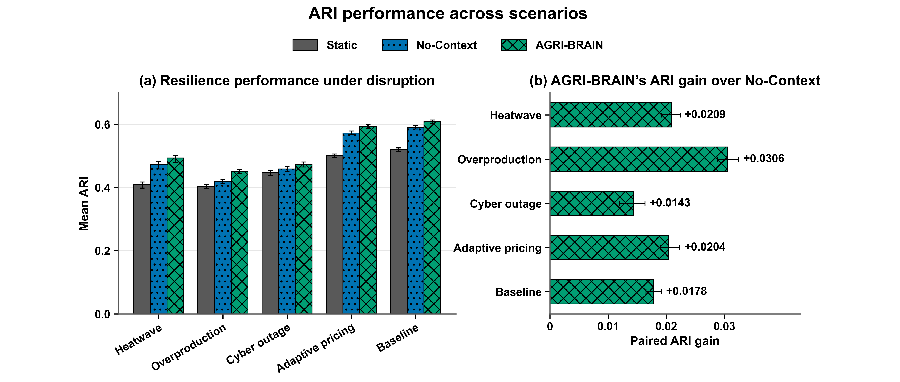
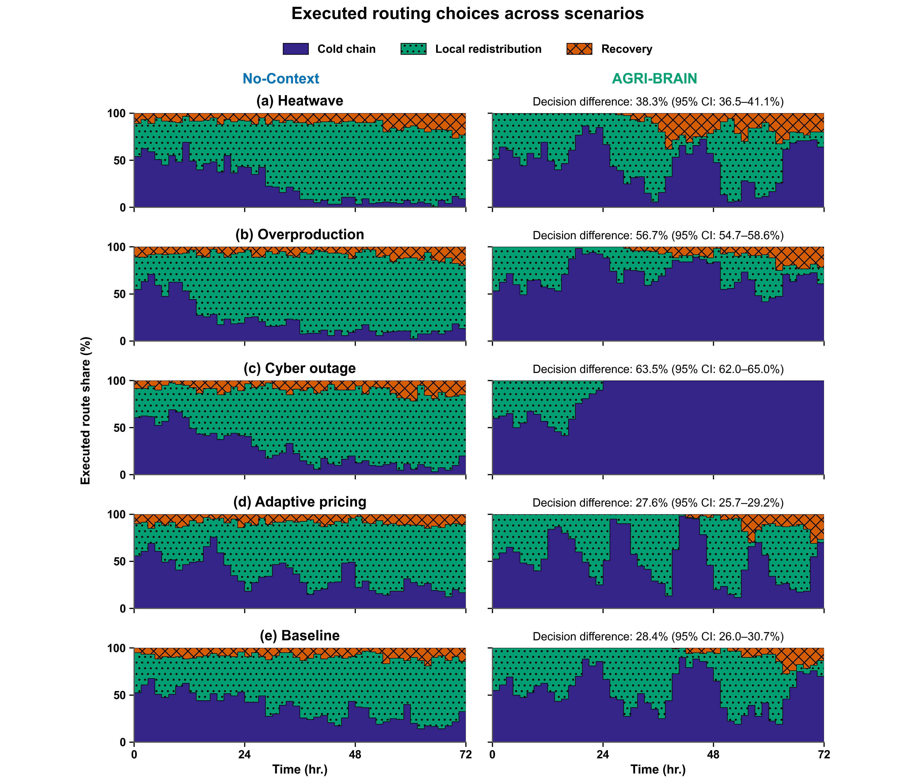
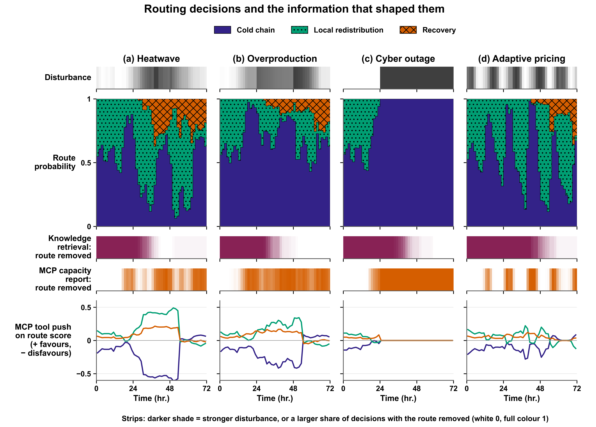
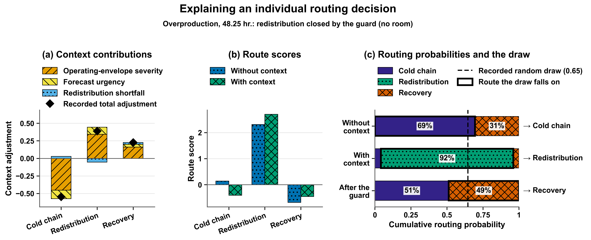
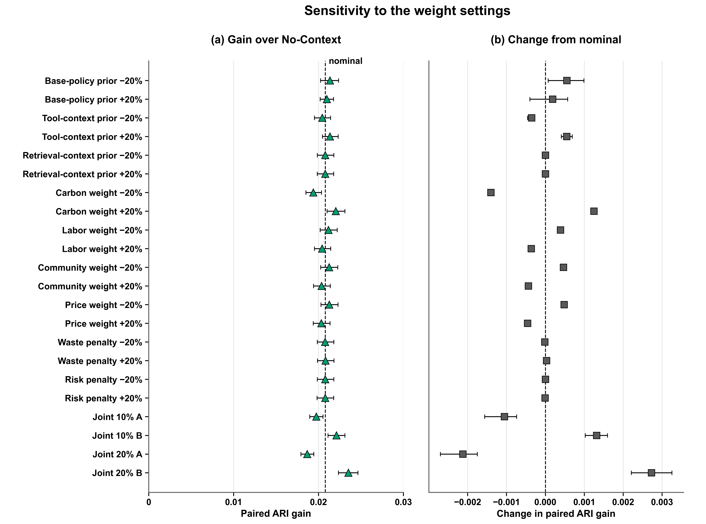

# Figures

Final figures of the study. The pipeline diagram is [`docs/images/architecture.png`](../docs/images/architecture.png) and is shown in the [main README](../README.md). Captions, data sources and the script behind each figure are also machine-readable in [`figure_index.json`](figure_index.json).

| Figure | File |
|---|---|
| [ARI performance across scenarios](#ari-performance-by-scenario) | `ari_performance_by_scenario.png` |
| [Executed routing choices across scenarios](#executed-routing-choices) | `executed_routing_choices.png` |
| [Routing decisions and the information that shaped them](#routing-decisions-and-information) | `routing_decisions_and_information.png` |
| [Explaining an individual routing decision](#routing-decision-explanation) | `routing_decision_explanation.png` |
| [Sensitivity to the weight settings](#weight-sensitivity) | `weight_sensitivity.png` |

Every figure can be regenerated from the files in this repository. From the repository root:

```bash
python -m pip install -r analysis/requirements.txt
python analysis/make_figures.py --output figures_regenerated --compare
```

With the library versions in `analysis/requirements.txt` and the Arial font, the regenerated images are byte-identical to the files here; in another environment only the rendering differs. The route, timing and single-decision figures read the per-decision records in `data/figure_inputs`, which keep only the fields the figures use.

<a id="ari-performance-by-scenario"></a>

## ARI performance across scenarios



Resilience across scenarios: (a) mean ARI and (b) paired gain over No-Context, with gains labeled.

Data: `data/study/modes.csv`, `data/study/comparisons_by_scenario.csv`.

<a id="executed-routing-choices"></a>

## Executed routing choices across scenarios



Executed routes in the separately adapted policies. Decision difference is the share of decisions on which the two policies execute different routes.

Data: `data/figure_inputs/agribrain`, `data/figure_inputs/no_context`, `data/study/seed_endpoints.csv`.

<a id="routing-decisions-and-information"></a>

## Routing decisions and the information that shaped them



AGRI-BRAIN’s routing over time and the information behind it in four scenarios. From top: the disturbance; the probability of each route after the guard; the share of decisions on which the guard removes a route because of the acceptance criteria from institutional knowledge retrieval, or because of the capacity reports received through the Model Context Protocol (MCP); and the push of the MCP tools on each route’s score. Retrieval removes recovery while the product is still too fresh to qualify; the capacity reports remove routes once the outlets fill or the reports stop. Means over 20 seeds in 1.5-h bins.

Data: `data/figure_inputs/agribrain`.

<a id="routing-decision-explanation"></a>

## Explaining an individual routing decision



Context contributions and their effects on routing probabilities in one decision on which the context changed the executed route.

Data: `data/figure_inputs/agribrain/direct_5001_overproduction.json.gz`.

<a id="weight-sensitivity"></a>

## Sensitivity to the weight settings



Weight sensitivity: (a) paired ARI gain over No-Context and (b) change in gain from nominal.

Data: `data/study/sensitivity_settings.csv`, `data/study/principal_comparisons.csv`.
